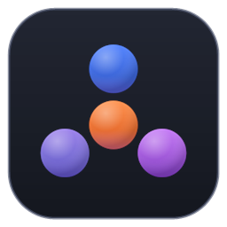
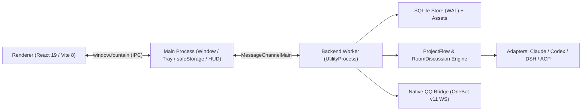

<div align="center">



# FountAIn

**本地多模型 AI 协作工作台 · 把多个顶尖大模型组织成一支真正能协同交付的桌面工程团队**

[](./LICENSE)
[](#环境要求与快速启动)
[](#技术栈与架构)
[](#技术栈与架构)
[](#技术栈与架构)

</div>

---

## 为什么做 FountAIn？

单模型 CLI 很强，但面对复杂的真实工程或研究任务时，单一模型往往存在视角盲区、长上下文退化和“既当运动员又当裁判”的幻觉风险。

**FountAIn** 将 **Claude Code、OpenAI Codex (ChatGPT)、DeepSeek Harness (DSH)** 以及任意兼容 **ACP (Agent Client Protocol)** 的执行端（如 Gemini、Qwen、Kimi、GLM、Grok、MiniMax 等）汇聚到同一个本地桌面工作台中——让不同模型在同一个项目房间里**分工讨论、起草方案、并行编码、交叉复核、证据核验、差异预览并安全写回**，同时支持通过原生 **QQ Bridge** 远程随时调度。

---

## 核心特性

### 1. 多模型编排与独立角色系统
- **原生多执行端支持**：内置 **Claude Code**、**Codex (ChatGPT)**、**DeepSeek Harness (DSH)**，并原生兼容标准 **ACP 协议**，可自由扩展接入 1 个、4 个乃至 9+ 个不同模型执行端。
- **独立立绘与角色设定**：内置 9 套角色立绘与主题色，支持自定义头像/立绘裁剪、性格设定（Persona）、称呼、长期记忆以及独立成员工位。
- **本地隔离与版本管理**：各成员 CLI 运行时、登录会话与工作区按目录隔离，内置便携 Node.js 校验与一键版本检测。

### 2. 三大协作空间：茶歇室 · 项目会议室 · 圆桌
| 空间 | 适用场景 | 能力特点 |
| --- | --- | --- |
| **茶歇室** | 自由闲聊、灵感碰撞、日常问答 | 多模型自由接话、支持 `@成员` 定向对话与成员间闲聊互动 |
| **项目会议室** | 真实代码/文档/研究项目交付 | 绑定本地项目目录，支持父子项目树管理、正式多轮流程、看板追踪、diff 验收与安全写回 |
| **圆桌评审** | 多方案盲评与深度交叉对比 | 各成员独立输出观点后再交叉互评，避免从众偏见 |

### 3. 工程化多轮交付与证据核验引擎
- **六阶段闭环流程**：`讨论 → 定负责人 → 起草方案 → 并行执行 → 整轮整合检查与交叉复核 → 人工 Diff 验收写回`。
- **独立副本与防误改**：正式流程任务在独立工作副本中执行，验收通过后再校验冲突并原子写回项目目录，保留撤销快照。
- **原生工具证据绑定**：自动解析各执行端（含 Claude / Codex / DSH / ACP `run_command`）的原生工具完成事件与退出码，杜绝“空口声称已测试通过”。
- **卡点透明与一键「问问负责人」**：流程遇到阻塞或待决策卡时，全体在场成员均能看到完整报错与决策上下文；决策卡内置 **「问问负责人」** 按钮，一键让负责人用通俗大白话解释卡点并给出选项建议。
- **三处状态实时同步**：顶部状态胶囊（`在做 / 待完成 / 待你决定`）、右侧看板泳道、底部任务进展与行内实时计时共享同一数据源。

### 4. 后台上下文管理员与本地图文预览
- **自动上下文压缩（Auto-Compaction）**：对话超过阈值（默认 24 条或 24,000 字）且空闲时，后台自动挑选最快的空闲成员（优先级：`DSH → Gemini → Codex → Claude → 其他 ACP`）浓缩为高保真交接摘要；也支持在「管理话题」中手动指定任意成员压缩。
- **本地图表直出与全屏灯箱**：成员在回复中用 Markdown 引用本地生成的图片/图表时，自动渲染高清预览卡片与顶层全屏灯箱。

### 5. 原生内置 QQ Bridge（OneBot v11 / NapCat）
- **零第三方依赖**：内置原生 RFC 6455 反向 WebSocket 服务端，轻量稳定，默认独立端口不与其他客户端冲突。
- **远程调度指令**：支持 QQ 私聊与群聊 `@` 触发、图文双向收发，支持 `/rooms`（查看房间）、`/use`（切换房间）、`/status`（查看状态）、`/stop`（紧急停止）。
- **单成员「当家」代理模式**：可指定某一位成员统一对外接待 QQ 消息，仅在其主动 `@` 其他成员时才唤醒团队协作。
- **状态可视化与静默自启**：左侧栏实时显示 QQ 在线状态与真实 QQ 头像，支持随应用启动后台静默拉起 NapCat 自动登录。

### 6. 桌面浮层、安全加密与可选结构化任务房
- **桌面置顶 HUD 浮层**：支持随时呼出精简桌面浮层与局域网手机端状态查看，监控成员状态、额度与第三方 API 账单。
- **系统级凭据加密**：所有 API Key、订阅 Token 与 ACP 密钥均通过 Electron `safeStorage` 调用 Windows DPAPI 加密存储，日志自动脱敏。
- **完整备份与校验恢复**：内置数据库 + 资源快照备份与 SHA-256 逐文件校验恢复机制（不包含个人登录凭据）。
- **可选结构化任务房模式**：当任意项目文件夹同时包含 `ROOM_BRIEF.md`、`HANDOFF.md`、`01_Drafts_and_Code/` 与 `02_Reviews_and_Debug/` 时，自动启用结构化写边界保护，并在每轮验收通过后自动更新门牌进度与交接日志；普通文件夹无需任何配置，开箱即用。

---

## 技术栈与架构

- **桌面端壳层**：Electron 44 + ContextIsolation + Sandbox + 自定义 `fountain-asset://` 只读资源协议
- **前端界面**：React 19 + TypeScript 7 + Vite 8 + Lucide Icons
- **后端核心**：独立 Electron `UtilityProcess` Worker + Node.js 原生 `node:sqlite` (WAL 模式) + Rolldown 打包



---

## 环境要求与快速启动

- **操作系统**：Windows 10 / 11 (x64)
- **Node.js**：`>= 22`（仅开发与源码构建需要；打包后的绿色版免 Node.js 直接运行）

```bash
# 1. 克隆仓库
git clone https://github.com/LaurenTxT/FountAIn.git
cd FountAIn

# 2. 安装依赖
npm install

# 3. 类型检查（TypeScript 7）
npm run typecheck

# 4. 开发模式构建并启动
npm run dev
```

生产构建与启动：

```bash
npm run build
npm start
```

---

## 打包分发

```bash
# 构建 Windows 安装包（NSIS）与便携单文件版（输出至 release/）
npm run package

# 构建 Windows 免安装绿色目录版（含 SHA-256 依赖校验与使用说明）
npm run package:green
```

打包后的桌面正式版默认将用户数据、SQLite 数据库与加密凭据保存在 `%USERPROFILE%\.fountain\data`，与源码仓库完全分离。

---

## QQ Bridge 配置简明指南

1. 在本地准备好支持 **OneBot v11 反向 WebSocket** 的协议端（如 NapCat）。
2. 在协议端新增一条反向 WebSocket 客户端连接，地址填：`ws://127.0.0.1:8644`（端口可自定义）。
3. 打开 FountAIn → **设置与连接 → QQ Bridge**，开启开关并核对端口、允许交互的 QQ 号/群号以及默认房间与“当家”成员。
4. 如需随应用启动自动拉起协议端，填入本地启动脚本路径并开启自动拉起即可。

---

## 目录结构

```text
FountAIn/
├── build/                 # 应用图标（fountain.ico / fountain.png）与第三方开源声明
├── public/                # 静态公共资源
├── scripts/               # 构建（Rolldown + Vite）、类型检查、图标嵌入与打包校验脚本
├── src/
│   ├── main/              # Electron 主进程、窗口/托盘、safeStorage 凭据管理、桌面 HUD
│   ├── backend/           # 独立 Worker：多模型适配器、会议调度、项目流程引擎、上下文压缩、QQ Bridge、SQLite
│   ├── renderer/          # React 19 前端：开场粒子动画、聊天室、项目看板、立绘舞台、设置中心
│   └── shared/            # 前后端共享类型、RPC 协议、状态补丁同步与工具事件解析
├── electron-builder.json  # Electron Builder 打包配置
├── package.json
└── tsconfig.json
```

---

## 常用脚本

| 命令 | 说明 |
| --- | --- |
| `npm run dev` | 编译全部产物并启动桌面端 |
| `npm run build` | 执行后端（Rolldown）与前端（Vite 8）全量生产构建 |
| `npm run typecheck` | 运行 TypeScript 7 全仓严格类型检查 |
| `npm start` | 启动已构建的桌面端 |
| `npm run package` | 打包 Windows 安装程序与便携版 |
| `npm run package:green` | 打包免安装绿色压缩包并生成 SHA-256 校验清单 |

---

## 隐私与安全设计

- **纯本地优先**：所有聊天记录、项目配置与工作副本仅保存在本地，不向任何第三方中转服务器上传数据。
- **凭据加密与脱敏**：密钥使用操作系统凭据保护加密落盘，启动日志与诊断导出自动脱敏。
- **零预置账号**：开源仓库与分发包均不包含任何开发者个人账号、密钥、聊天记录或私人路径。

---

## 许可证

本项目基于 [MIT License](./LICENSE) 开源，Copyright (c) 2026 Louisxx。
